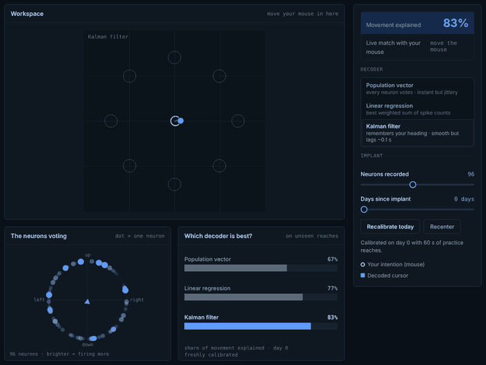
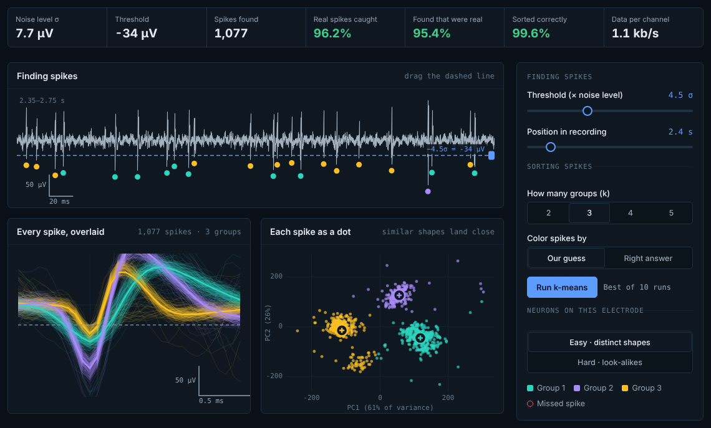

# Spikes to Cursor

An interactive, in-browser lesson on the signal processing behind brain–computer interfaces (BCIs): from raw electrode voltage to a decoded cursor. Built for a 40-minute class lesson (BIOE 538).

**[Live demo →](https://YOUR-USERNAME.github.io/spikes-to-cursor/)**



Everything is simulated in plain JavaScript, so there is nothing to install and no server. Because the recording is synthetic, the app knows the true spike times and scores every stage of the pipeline against ground truth.



## The lesson

| Stage | Question | What students do |
|---|---|---|
| 00 · The bandwidth problem | Why can't an implant just stream everything? | Compare raw samples, waveforms, spike events and binned counts against a ~1 Mb/s radio budget |
| 01 · Raw signal & filtering | Where are the spikes? | Tune a Butterworth band-pass, watch the power spectrum, compare causal (implant) and zero-phase (offline) filtering |
| 02 · Detection & sorting | Which neuron fired? | Drag a threshold, watch recall and precision trade off, run PCA and an animated k-means, reveal ground truth |
| 03 · Decoding intent | How do neurons encode movement? | Move the mouse as "intent", watch cosine-tuned neurons vote, compare population vector, linear and Kalman decoders, simulate 30 days of drift and recalibrate |
| 04 · Webgrid challenge | Can you control it? | 30-second closed-loop grid task scored in bits per second, with a class leaderboard for one projected screen |
| 05 · What's still hard | What's next? | Drift, power and heat, electrode longevity, speech and handwriting BCIs |

Every stage opens with an "In plain words" explanation and an everyday analogy, and technical terms can be clicked for a short definition, so the lesson works for students without a neuroscience or signal processing background. The equations are marked optional.

## What's implemented

- **Synthetic extracellular recording** (`js/core/recording.js`): LFP, 60 Hz mains pickup, thermal noise, 48 background neurons, and three nearby neurons with known spike times and refractory periods.
- **DSP** (`js/core/dsp.js`): Butterworth band-pass as cascaded biquads (second-order sections), causal and zero-phase filtering, frequency response, radix-2 FFT, Welch PSD, and the median-based noise estimate σ = median(|x|)/0.6745.
- **Spike sorting** (`js/core/sorting.js`): threshold detection with dead time, snippet extraction, PCA via Jacobi eigendecomposition, k-means++ with restarts, and scoring against ground truth.
- **Shared pipeline** (`js/core/pipeline.js`): a filter choice in Stage 1 carries through to detection and sorting in Stage 2, the way it would on an implant.
- **Motor cortex and decoders** (`js/core/decoding.js`): cosine-tuned Poisson neurons in 20 ms bins, center-out calibration with minimum-jerk reaches, a weighted population vector, ridge regression, and a steady-state Kalman filter (gain computed once via the matrix inversion lemma, so each step is O(neurons)). Day-to-day drift rotates tuning, shifts baselines and drops neurons.
- **Webgrid** (`js/sections/webgrid.js`): pointer-locked closed-loop control and the achieved-bitrate metric, B = log₂(N − 1) · max(0, correct − wrong) / t.

## Results worth discussing

From the tests (96 neurons, held-out reaches):

| Decoder | Variance explained (offline) | Lag | Jitter at rest |
|---|---|---|---|
| Population vector | 67% | 0 ms | highest |
| Linear regression | 77% | 0 ms | medium |
| Kalman filter | 83% | ~100 ms | lowest |

In a simulated closed-loop player (`tests/closedloop.test.mjs`), the Kalman filter's lag costs more than its smoothness gains, so the simpler decoders score more bits per second. Offline accuracy is not online controllability, the gap that ReFIT (Gilja et al., 2012) was designed to close. A Kalman decoder calibrated on day 0 falls from 83% to about 30% variance explained by day 30 until it is recalibrated.

The `core/` modules have no DOM dependencies and are tested in Node:

```bash
node tests/core.test.mjs        # filters, detection, PCA, k-means against ground truth
node tests/decoding.test.mjs    # decoder accuracy vs. neuron count, drift
node tests/closedloop.test.mjs  # simulated Webgrid player for each decoder
```

## Running locally

The app uses ES modules, which browsers won't load from `file://`. Serve the folder instead:

```bash
python3 -m http.server 8000
# then open http://localhost:8000
```

## Presenting

- `←` / `→` or a presentation clicker (PageUp / PageDown) moves between stages.
- The lesson clock in the sidebar highlights the stage you should be on.
- The theme button switches light/dark; light usually reads better on a projector.

## References

- Neuralink Compression Challenge: 1,024 electrodes, 20 kHz, 10-bit samples, ~1 Mb/s wireless. <https://content.neuralink.com/compression-challenge/README.html>
- Quiroga, Nadasdy & Ben-Shaul (2004). Unsupervised spike detection and sorting with wavelets and superparamagnetic clustering. *Neural Computation*.
- Trautmann et al. (2019). Accurate estimation of neural population dynamics without spike sorting. *Neuron*.
- Georgopoulos et al. (1982, 1986). Cosine tuning and the population vector in motor cortex.
- Wu et al. (2003). Neural decoding of cursor motion using a Kalman filter. *NeurIPS*.
- Gilja et al. (2012). A high-performance neural prosthesis enabled by control algorithm design. *Nature Neuroscience*.
- Nuyujukian et al. (2015). A high-performance keyboard neural prosthesis enabled by task optimization. *IEEE TBME*.
- Neuralink Webgrid. <https://neuralink.com/webgrid>
